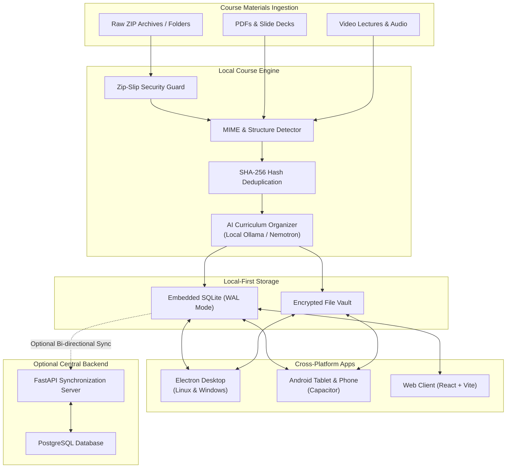

# CourseNest 🎓
> **Local-First, AI-Assisted Offline Learning Platform**

[](https://github.com/coursenest/coursenest/actions)
[](https://opensource.org/licenses/Apache-2.0)
[](https://nodejs.org/)
[](https://python.org/)
[](https://pnpm.io/)
[](CONTRIBUTING.md)

CourseNest is a modern, privacy-respecting, **local-first learning platform** built for university students and instructors. It takes unorganized course folders, PDFs, slide decks, video lectures, and ZIP archives, and automatically structures them into beautiful, offline-capable courses inspired by the study experience of Coursera and Udemy.

---

## ⚡ 1. What is CourseNest?

Educational materials distributed by universities often arrive as disorganized ZIP archives, poorly named files, missing lesson numbers, or arbitrary folders. Students frequently lack reliable campus internet or need to study while commuting, traveling, or offline.

CourseNest solves this by combining:
1. **Genuine Local-First Architecture**: Your courses, downloaded videos, notes, progress, bookmarks, and quiz attempts live in an embedded SQLite database on your device. **Zero internet connection required** after material is imported.
2. **Intelligent Ingestion Pipeline**: Deterministic file hierarchy organizer with built-in Zip-Slip protection, SHA-256 deduplication, and optional local AI (Ollama / Nemotron / Llama) or cloud LLM structuring.
3. **Rich Learning Player**: Smooth video playback, synchronized transcripts, markdown study guides, PDF readers, inline note-taking, and progress tracking.
4. **Cross-Platform Availability**: Runs as an **Electron Desktop App** (Linux & Windows), an **Android App** (Tablets & Phones), and a **Web Client**.
5. **Optional University Sync Backend**: Optional FastAPI + PostgreSQL central server for automated distribution, university accounts, and multi-device progress sync.



---

## 🚀 2. Run in Under 5 Minutes

### Option A: One-Command Setup (Docker Compose) 🐳

The fastest way to spin up the entire CourseNest stack (PostgreSQL + FastAPI backend + Web Client):

```bash
# Clone the repository
git clone https://github.com/coursenest/coursenest.git
cd coursenest

# Launch the full stack
docker compose up -d
```

- **Web Application**: Visit [http://localhost](http://localhost)
- **API Documentation**: Visit [http://localhost:8000/docs](http://localhost:8000/docs)
- **Database**: PostgreSQL 16 on port `5432` with pre-seeded test courses

---

### Option B: Local Bare-Metal Setup (pnpm) 💻

If you are developing locally or running the Electron desktop app:

#### 1. Prerequisites
- **Node.js**: `>= 20.0.0` (v22 recommended)
- **pnpm**: `>= 9.0.0`
- **Python**: `>= 3.11` (for backend server)

#### 2. Install & Build Monorepo
```bash
# Install workspace dependencies
pnpm install

# Build shared packages (domain, SQLite adapter, UI, importer)
pnpm build:packages
```

#### 3. Run Applications
- **Web Client**:
  ```bash
  pnpm dev
  # Open http://localhost:5173
  ```

- **Electron Desktop Application**:
  ```bash
  pnpm dev:desktop
  ```

- **Python FastAPI Backend** (Optional):
  ```bash
  cd apps/server
  python -m venv .venv
  source .venv/bin/activate
  pip install -e .
  alembic upgrade head
  uvicorn app.main:app --reload --port 8000
  ```

---

## 📂 3. Monorepo Structure

```
coursenest/
├── apps/
│   ├── client/               # React 18 + Vite Web Application & Course Player
│   ├── desktop/              # Electron Desktop Application (Linux & Windows)
│   ├── android/              # Capacitor Android Native Shell (Phones & Tablets)
│   └── server/               # FastAPI backend with asyncpg, SQLAlchemy 2 & Alembic
│
├── packages/
│   ├── domain/               # Pure domain entities, branded IDs & TypeScript types
│   ├── database-contracts/   # Decoupled repository contracts (DIP)
│   ├── sqlite-adapter/       # Local SQLite storage driver with WAL & foreign keys
│   ├── storage-adapters/     # File storage abstraction (Local Disk, Memory, S3)
│   ├── importer/             # Material parser, zip extractor & curriculum organizer
│   ├── course-manifest/      # Portable JSON course specification & serializer
│   ├── validation/           # Zod runtime schemas & input validation
│   ├── ui/                   # Shared UI component library & design system
│   └── config/               # Shared constants, environment & theme configurations
│
├── fixtures/courses/         # Portable seed curricula (CS101 Systems, ML201)
├── docker-compose.yml        # One-command containerized production stack
├── .github/                  # CI workflows, issue templates & PR templates
├── CONTRIBUTING.md           # Guide for open-source contributors
└── LICENSE                   # Apache License 2.0
```

---

## 🌟 4. Good First Issues (Start Contributing!)

We welcome contributors of all experience levels! If you'd like to get your feet wet, check out these beginner-friendly tasks:

| Issue | Area | Description |
| :--- | :--- | :--- |
| **Markdown Syntax Highlighting** | `client` `ui` | Add syntax code block highlighting to the player using `shiki` or `prism`. |
| **Keyboard Shortcuts for Player** | `player` `a11y` | Add `Alt + Left/Right` to skip lessons and `Space` to toggle video playback. |
| **Notes Export as Markdown** | `notes` `client` | Add a button in the notes sidebar to export student notes as a `.md` file. |
| **EPUB & Notebook Detection** | `importer` | Add `.ipynb` and `.epub` heuristics in `packages/importer/src/detector.ts`. |
| **Dark Mode Contrast Polish** | `ui` `css` | Refine WCAG AA contrast colors in `apps/client/src/styles/global.css`. |

Browse all open beginner issues tagged [`good-first-issue`](https://github.com/coursenest/coursenest/labels/good-first-issue).

---

## 🧪 5. Testing & Verification

We enforce strict test suites across TypeScript and Python:

```bash
# Run unit tests across all TypeScript packages (including SQLite adapter)
pnpm test

# Run TypeScript typechecks
pnpm typecheck

# Check code formatting
pnpm format:check

# Run Python server tests
cd apps/server && pytest tests/
```

---

## 📄 6. License

CourseNest is licensed under the **[Apache License 2.0](LICENSE)**.

You are free to use, modify, distribute, and integrate CourseNest in commercial and private projects under the terms of the Apache-2.0 license.
