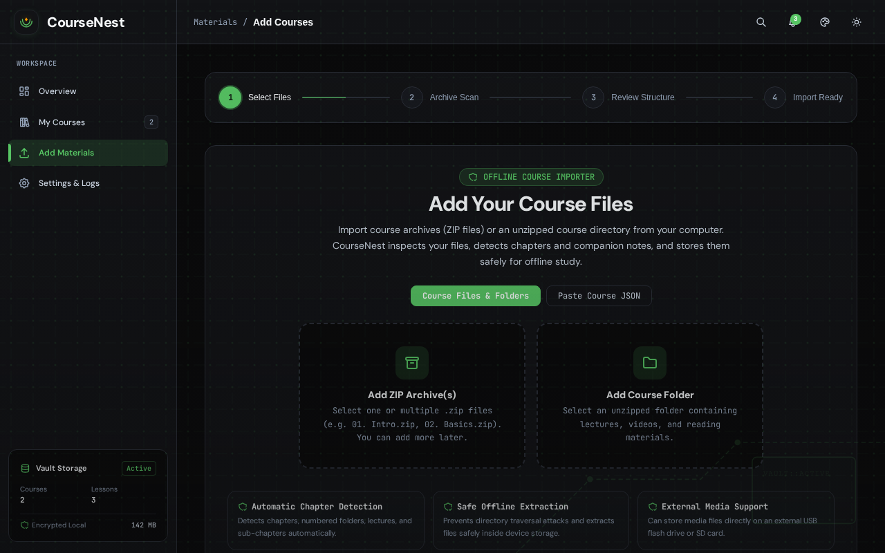
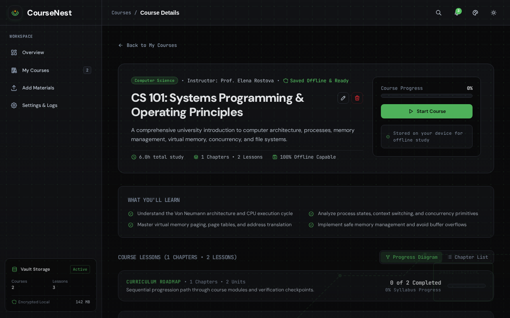
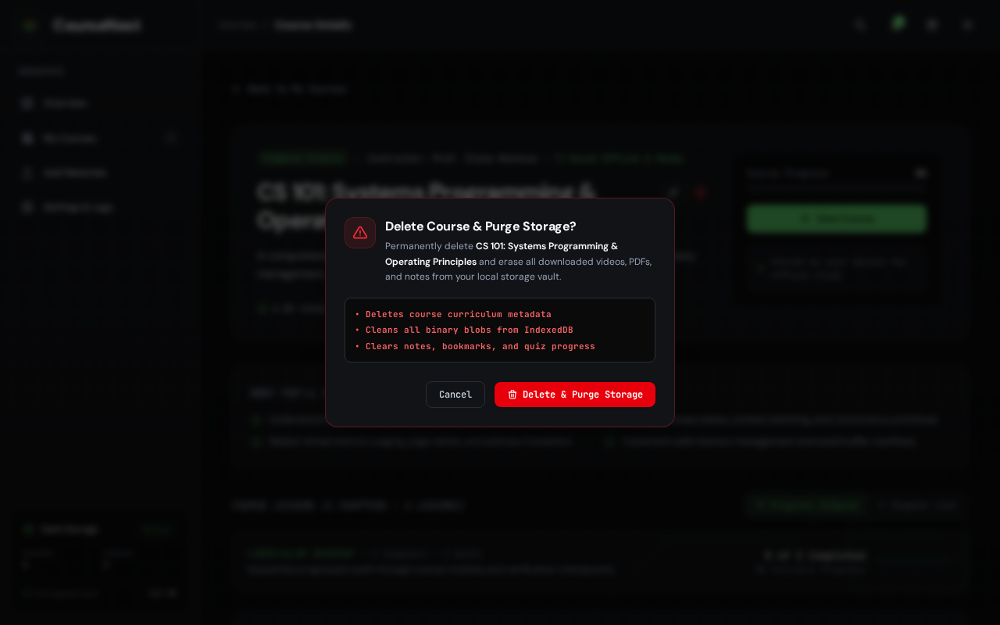
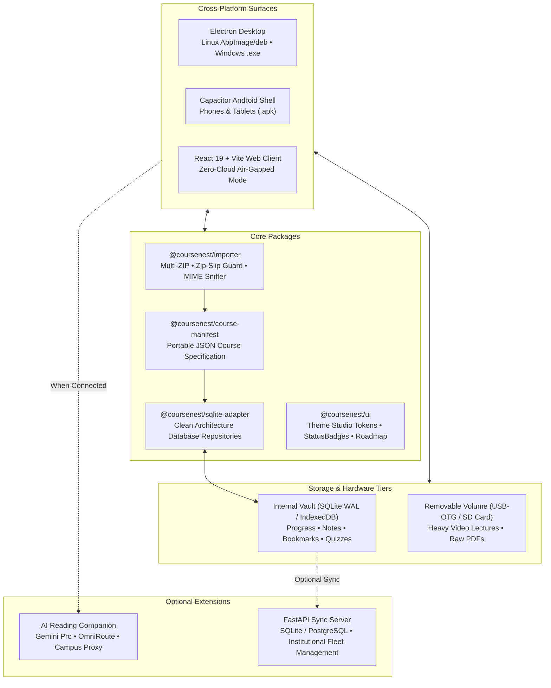

# CourseNest 🎓
> **Open-Source, Local-First, Multi-Audience Educational Studio & Course Player**

[](https://opensource.org/licenses/Apache-2.0)
[](https://nodejs.org/)
[](https://www.typescriptlang.org/)
[](https://python.org/)
[](https://www.electronjs.org/)
[](https://capacitorjs.com/)
[](https://pnpm.io/)
[](CONTRIBUTING.md)

CourseNest is a modern, privacy-first, **air-gapped educational platform** designed for students, educators, and institutions. It ingests unorganized course folders, PDFs, slide decks, video lectures, and partitioned multi-archive ZIP packages, structuring them into an interactive self-contained learning curriculum inspired by Coursera, Udemy, and Nuzz.space.

---

## 🎨 Multi-Audience Theme & Aesthetic Studio

CourseNest features a **built-in 9-theme design studio** with bespoke typography (SIL OFL open-source fonts), atmospheric SVG scenic artwork with contrast scrims, theme-adaptive vector logos, and zero-CPU pure CSS GPU keyframe loaders:

| Theme | Aesthetic Character | Emblem & Backdrop | Display Typography |
| :--- | :--- | :--- | :--- |
| 🕌 **Halal Edition** | Islamic modesty & serenity | Rub el Hizb 8-point geometric star & Mosque minaret skyline | Plus Jakarta Sans |
| 🌸 **Sakura Bloom** | Kawaii pastel & cozy floral | 5-petal cherry blossom seal & Mt. Fuji Japanese garden vista | Nunito Rounded |
| 🧱 **Toybox Playful** | Children & claymorphism | 3D interlocking brick & bubbly floating landscape | Fredoka Bubbly |
| ⚡ **Neo-Tokyo Mecha** | High-tech cyberpunk | HUD targeting reticle & neon metropolis skyline | Chakra Petch Tech |
| 💥 **Manga Screentone** | Japanese comic action | Comic burst stamp, halftone screentone & speedlines | Chakra Petch Bold |
| 🍃 **Studio Ghibli Nature** | Whimsical woodland meadow | Sprouting seedling & ancient camphor tree canopy | DM Sans Organic |
| 🪨 **Obsidian Moss** | Deep-focus engineering | Monolith geometric blueprint & emerald glow | DM Sans Slate |
| 🌑 **OLED Midnight** | 0% true black battery saver | Celestial orbital ring & emerald hairlines | JetBrains Mono |
| 📰 **Clean Editorial** | Daylight academic paper | Swiss drafting grid & minimalist layout | Inter / DM Sans |

> **Reusable Engine**: The entire theme engine is packaged as a standalone, turnkey skill at [`.agents/skills/theme-customization-studio/`](.agents/skills/theme-customization-studio/).

---

## 📸 Visual Showcase & UI Gallery

| Learning Overview (Obsidian Moss) | Multi-Archive Importer (4-Step Stepper) |
| :---: | :---: |
|  |  |

| Course Dossier & Inline Title Editor | Storage Purge Confirmation Modal |
| :---: | :---: |
|  |  |

| 🕌 Halal Edition Wallpaper | 🌸 Sakura Bloom Garden |
| :---: | :---: |
|  |  |

| 🧱 Toybox Playful Valley | ⚡ Neo-Tokyo Mecha Skyline |
| :---: | :---: |
|  |  |

---

## 🎯 Design Engineering & Polish (Emil Kowalski Philosophy)

The user interface follows strict design engineering standards:
* **Zero `transition: all`**: Every transition in the codebase explicitly targets composite-only GPU properties (`transform`, `opacity`, `background-color`, `border-color`, `box-shadow`) to maintain a steady 60fps frame budget.
* **Physical `:active` Feedback**: Buttons and cards give immediate tactile feedback (`scale(0.97)` / `active:scale-95`). In the Manga theme, buttons physically compress into the page (`translate(1px, 1px)` with reduced shadow).
* **Origin-Aware Popovers**: Dropdowns and popovers (such as the notification flyout) scale from their trigger origin (`origin-top-right zoom-in-95 ease-out`), while dialog modals remain centered in the viewport.
* **Custom Cubic-Bezier Easing**: Uses strong deceleration curves (`--ease-out: cubic-bezier(0.23, 1, 0.32, 1)`) rather than sluggish browser defaults.
* **Accessibility & Touch Safeguards**: Full `@media (prefers-reduced-motion: reduce)` motion dampening and `@media (hover: none)` sticky-hover prevention for touch screens.

---

## ⚡ Core Architectural Pillars

### 1. 100% Offline-First Learning Core (Zero Cloud Overhead)
* **Zero Telemetry or Remote Tracking**: All course manifests, notes, bookmarks, quiz scores, and video progress are saved strictly to local device storage (SQLite WAL / IndexedDB).
* **Low-End Hardware Optimization**: Students with budget dual-core laptops run the application with **0% idle CPU**. The app loads instantly and does not strain battery life or system memory.
* **HashRouter Navigation**: Complete independence from web server rewrites—works under `http://`, `file://`, and Android WebView.

### 2. VLC-Grade Media Suite Player
* **200% Web Audio Super-Gain Booster**: Amplifies quiet professor recordings up to double standard volume using the Web Audio API.
* **Speech Presence Clarity Equalizer**: A dedicated Biquad bandpass boost (+6dB @ 2.5kHz) brings vocal frequencies to the foreground over background room echo.
* **Frame-by-Frame Stepper**: Step backward or forward by exactly 1/30th of a second for technical diagrams or code walkthroughs.
* **A-B Looping**: Set custom loop markers to repeat difficult lecture segments continuously.
* **External `vlc://` Protocol Bridge**: One-click stream handoff to desktop VLC Media Player.

### 3. Decoupled Media Tier & Storage Disconnection Resilience
* **Separation of State and Multimedia**: Heavy video files can be stored on removable USB flash drives or external SD cards, while learning state (notes, progress, quiz submissions) resides on internal device storage.
* **Unplugged Resilience**: If an external media drive is unexpectedly unplugged during playback, the application preserves all notes and checkpoint data, transitions gracefully to an informative reconnect prompt, and automatically resumes video upon re-insertion.

#### 🗄️ Where Are Decompressed Files Stored? (e.g. LangChain Course)
CourseNest operates with an **air-gapped, zero-cloud architecture**. Decompressed archive files and media are stored depending on your runtime surface:

1. **Web Browser (PWA / Chrome / Firefox)**:
   - **Binary Media Blobs (Video, PDF, Audio)**: Stored directly in the browser's high-performance **IndexedDB** database under `coursenest_media_vault_v1`, in the `media_files` object store. Each file is keyed by `${courseId}::${filePath}` (e.g., `langchain-101::01-intro/lecture.mp4`).
   - **Course Manifests & Tree Structure**: Persisted in `localStorage` (`coursenest_custom_courses_v1`), containing structured chapter outlines, lesson trees, and durations.
   - **Progress & User State**: Persisted in `localStorage` under `coursenest_course_progress_v1` and `coursenest_lesson_notes_v1`.
   - **Storage Purge on Deletion**: When you click **Delete Course**, `deleteCourseFromVault(courseId)` opens a transaction against IndexedDB and permanently purges every binary chunk associated with that course ID, immediately reclaiming browser disk space.
2. **Electron Desktop (Windows / Linux / macOS)**:
   - Stored in the local user data folder:
     - **Windows**: `%APPDATA%\CourseNest\vault\courses\{course_id}\`
     - **Linux**: `~/.config/CourseNest/vault/courses/{course_id}/`
     - **macOS**: `~/Library/Application Support/CourseNest/vault/courses/{course_id}/`
   - Mirrored into desktop Chromium IndexedDB for instant streaming.
   - Course deletion unlinks both the filesystem directory and the IndexedDB records.
3. **FastAPI Institutional Central Server (Optional)**:
   - Stored on server disk under `apps/server/storage/courses/{course_id}/`.
   - Course deletion asynchronously purges the directory and metadata.

### 4. Hardened Multi-Archive Ingestion Pipeline
* **Multi-ZIP Aggregation**: Supports selecting and merging multiple ZIP archives representing a single course in one folder.
* **Zip Slip Defense**: Canonical path boundary validation strictly rejects archive entries containing `../`, root paths, or null bytes (`\0`).
* **Atomic Staging & Rollback**: Ingestion executes inside a temporary staging sandbox. If any validation fails, partial state is automatically rolled back to prevent corrupting the local vault.
* **Untrusted Code Sandboxing**: Ingested `.html`, `.js`, `.py`, or `.sh` files are parsed strictly as plain text within an inert preview pane—preventing arbitrary local code execution.

### 5. Optional Bring-Your-Own-API (BYO-API) Companion
* **The "Offline-First + AI" Hybrid Model**: Running heavy local LLMs would freeze older laptops and exhaust RAM. CourseNest solves this by keeping the entire learning core 100% offline, while offering an **optional cloud/LAN AI assistant**.
* **Bring-Your-Own-API**: When online or on a school campus network, students can connect their own **Google Gemini Pro** API key or point to a school **OmniRoute / OpenAI-compatible** gateway.
* **Air-Gap Graceful Degradation**: If disconnected from the internet or if no API key is set, 100% of video, PDF, quiz, and note features remain fully accessible without errors.

---

## 🛠️ Monorepo Architecture



---

## 🚀 Quickstart & Testing

### 1. Prerequisites
- **Node.js**: `>= 20.0.0` (LTS recommended)
- **pnpm**: `>= 9.0.0`
- **Python**: `>= 3.11` (for optional FastAPI backend)

### 2. Monorepo Installation & Build
```bash
# Clone the repository
git clone https://github.com/PixelApprentice/Korse.git
cd Korse

# Install all workspace dependencies
pnpm install

# Build all packages and the client
pnpm build
```

### 3. Launching the Applications
- **Web Client (Live Testing)**:
  ```bash
  pnpm dev
  # Open http://localhost:5173
  ```
  *Immediately explore pre-bundled university courses ("CS 101: Systems Programming & Operating Principles" & "Machine Learning: Algorithms & Inference") with video lectures, lecture notes, and quizzes, or navigate to `/import` to drag-and-drop your own `.zip` archives or video folders.*

- **Electron Desktop Application**:
  ```bash
  pnpm dev:desktop
  ```

- **Python FastAPI Central Server (Optional)**:
  ```bash
  cd apps/server
  python -m venv .venv
  source .venv/bin/activate
  pip install -e .
  uvicorn app.main:app --host 127.0.0.1 --port 8000
  # API Docs: http://localhost:8000/docs
  ```

---

## 📦 Building Platform Packages

### 🪟 Windows Desktop (`.exe` Installer)
CourseNest uses `electron-builder` with an NSIS target to package standalone Windows installers:
```bash
# Build desktop assets
pnpm --filter @coursenest/client build
pnpm --filter @coursenest/desktop build

# Build Windows NSIS executable installer & portable .exe
cd apps/desktop
pnpm dist:win
# Output located in: apps/desktop/release/CourseNest-Setup-0.1.0.exe
```

#### 🛡️ Windows 11 SmartScreen Notice
The installer runs with user-mode privileges (`requestedExecutionLevel: asInvoker`) and does not require administrative privileges. If Windows Defender SmartScreen asks for confirmation:
1. Click **"More info"**.
2. Click **"Run anyway"**.

### 📱 Android Tablet & Mobile (`.apk`)
CourseNest uses Capacitor 7 to embed the React client into a native Android application:
```bash
# 1. Build the client web assets
pnpm --filter @coursenest/client build

# 2. Sync web assets into Android
cd apps/android
npx cap sync android

# 3. Compile the debug APK using Gradle
cd android
./gradlew assembleDebug
# Output APK: apps/android/android/app/build/outputs/apk/debug/app-debug.apk
```

### 🐧 Linux Desktop (`.AppImage` & `.deb`)
```bash
cd apps/desktop
pnpm dist:linux
# Output: apps/desktop/release/*.AppImage and *.deb
```

---

## 🧪 Testing & Verification

```bash
# 1. Monorepo unit test suites (importer, sqlite-adapter, domain)
pnpm -r test

# 2. Client TypeScript & Vite build
pnpm --filter @coursenest/client build

# 3. FastAPI pytest suite
cd apps/server && .venv/bin/pytest -v
```

---

## 📄 License

CourseNest is open-source software licensed under the **[Apache License 2.0](LICENSE)**.
Feel free to use, modify, distribute, and integrate CourseNest in personal, educational, or commercial projects.
