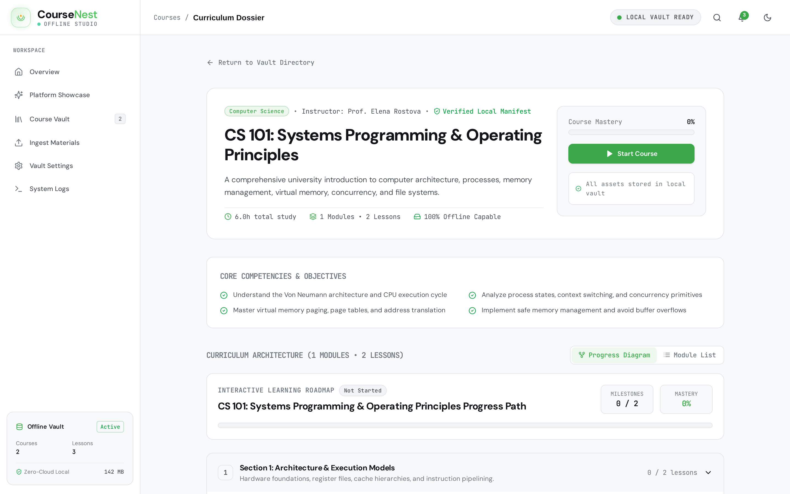
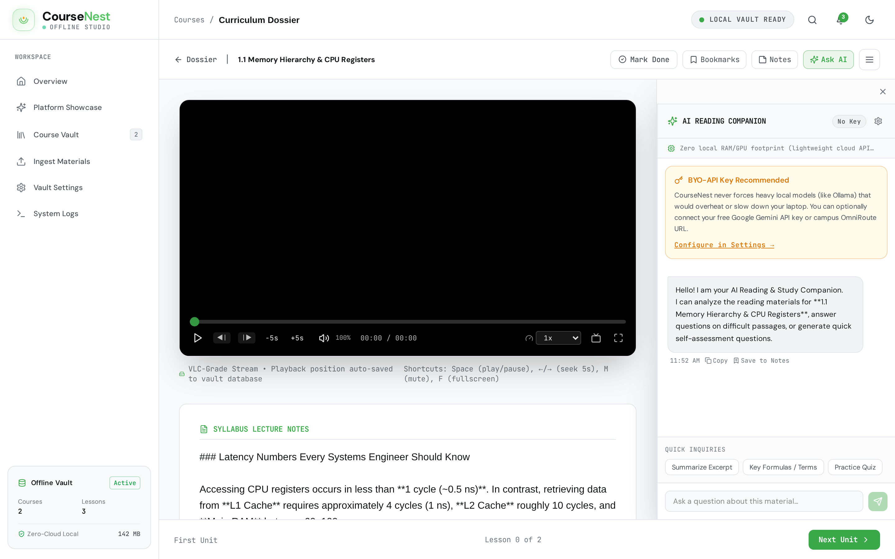
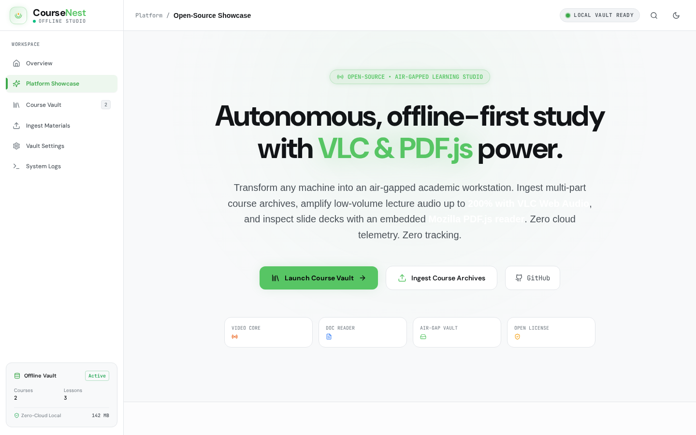
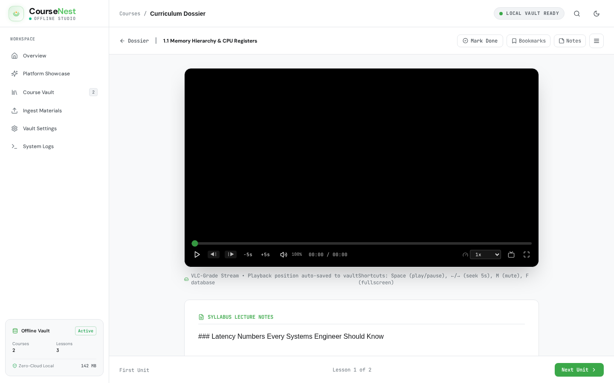
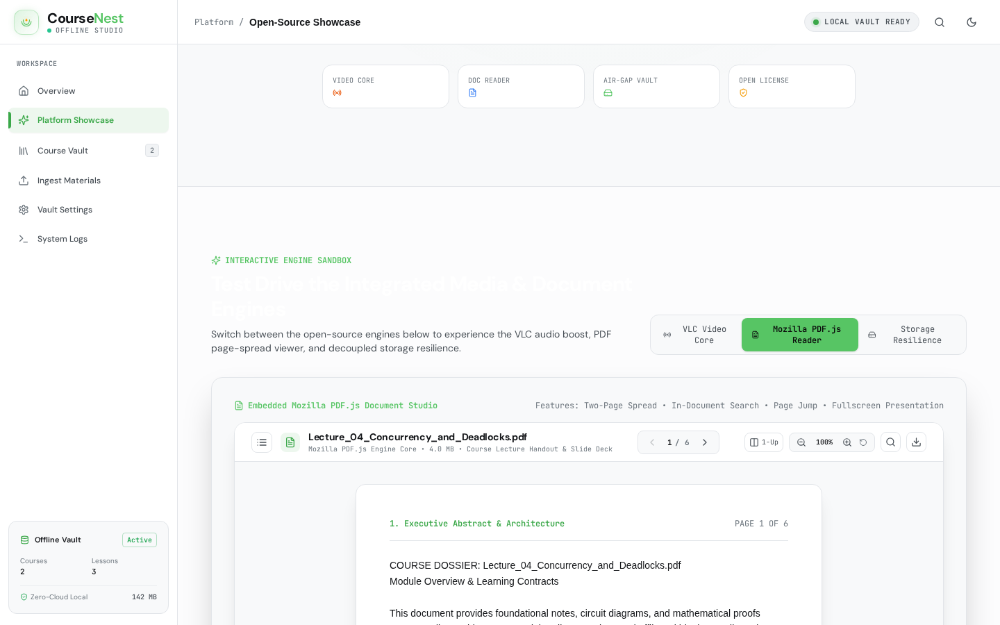
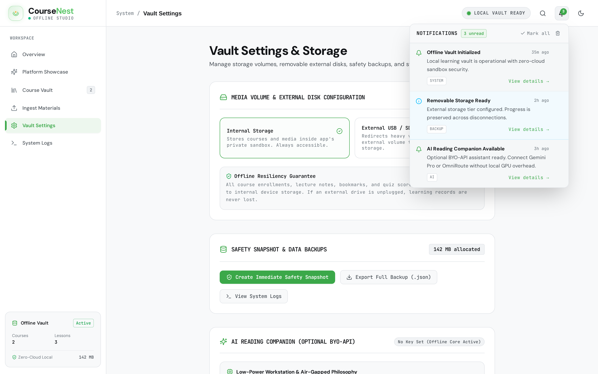
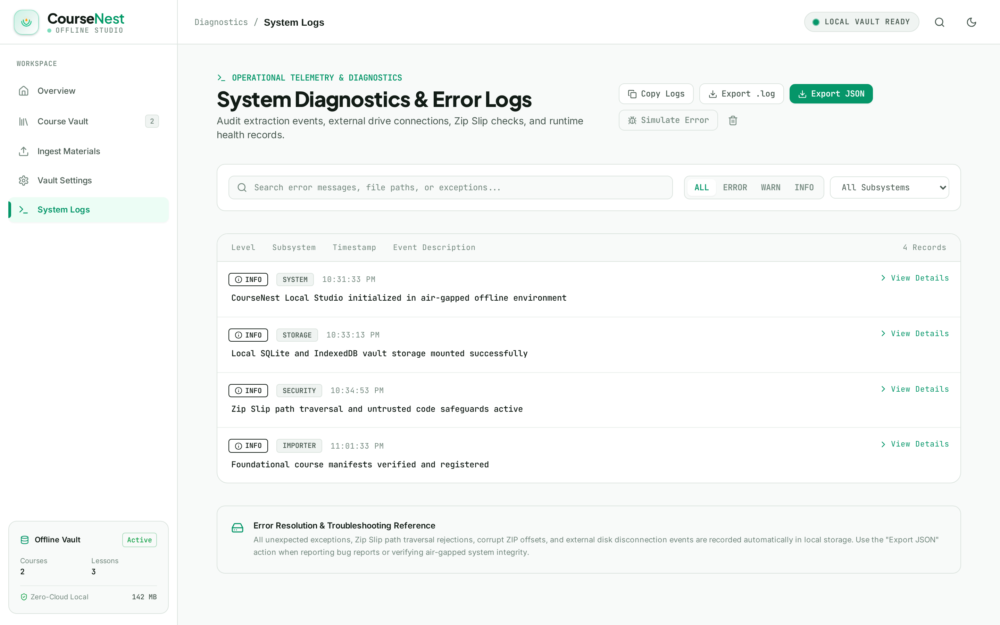
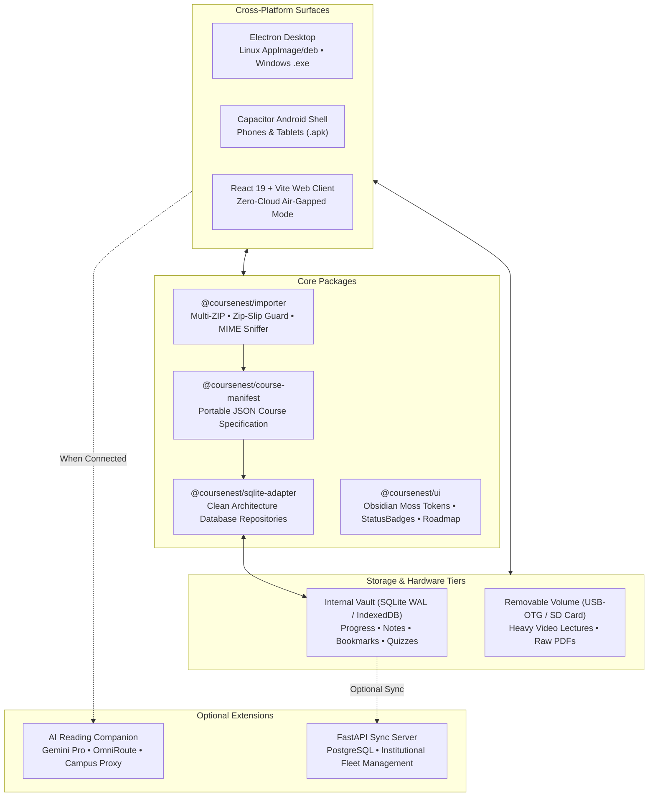

# CourseNest 🎓
> **Open-Source, Local-First, AI-Assisted Educational Studio & Course Player**

[](https://opensource.org/licenses/Apache-2.0)
[](https://nodejs.org/)
[](https://www.typescriptlang.org/)
[](https://python.org/)
[](https://www.electronjs.org/)
[](https://capacitorjs.com/)
[](https://pnpm.io/)
[](CONTRIBUTING.md)

CourseNest is a modern, privacy-respecting, **air-gapped educational platform** designed for students, educators, and institutions. It ingests unorganized course folders, PDFs, slide decks, video lectures, and partitioned multi-archive ZIP packages, structuring them into a rich, self-contained learning curriculum inspired by Coursera, Udemy, and Nuzz.space.

---

## 📸 Visual Showcase & Platform Tour

<div align="center">

### Interactive Curriculum Roadmap & Progress Path
*Visual node-based curriculum pipeline with completion checkmarks, active lesson tracking, and direct milestone navigation.*


<br/><br/>

### AI Academic Reading Companion (Optional BYO-API)
*Instant lecture handout Q&A, formula explanations, and 1-click note-saving via Google Gemini Pro or campus OmniRoute without local GPU overhead. Subtitle cues (`.vtt` / `.srt`) are automatically connected to provide precise timestamped references (e.g. `[04:20]`) that jump the video player on click.*


<br/><br/>

### Open-Source Platform Showcase (`/welcome`)
*Live interactive engine sandbox inspired by Kiwix, Kolibri, VLC, and Nuzz.space.*


<br/><br/>

### VLC-Grade Media Suite Player
*200% Web Audio API super-gain booster, speech presence clarity equalizer (+6dB @ 2.5kHz), A-B looper, frame stepper, and native `vlc://` launcher.*


<br/><br/>

### Mozilla PDF.js Document Studio Reader
*Two-page book spread, in-document keyword search with match counter, zoom presets (50%-225%), and chapter outlines.*


<br/><br/>

### Priority Notification Center & System Alerts
*Real-time notifications inspired by SSGI Training-Request with priority badges, storage disconnect warnings, and formatted timestamps.*


<br/><br/>

### Multi-ZIP Sandboxed Course Ingest Wizard
*Atomically merges multiple partitioned ZIP archives for a single course with Zip-Slip path traversal protection.*


<br/><br/>

### Diagnostic Event Logging & Audit Trail
*500-event in-memory ring buffer with level filtering, one-click clipboard copying, and JSON diagnostic export.*


</div>

---

## ⚡ Core Architectural Pillars

### 1. 100% Offline-First Learning Core (Zero Cloud Overhead)
* **Zero Telemetry or Remote Lock-in**: All course manifests, notes, bookmarks, quiz scores, and video progress are saved strictly to the device's local sandboxed database (SQLite in WAL mode / IndexedDB).
* **Low-End Hardware Optimization**: Students with budget dual-core laptops (e.g. Celeron, Core i3, 4GB RAM) run the application with **0% idle CPU**. The app loads instantly and does not strain battery life or system memory.

### 2. Optional Bring-Your-Own-API (BYO-API) Companion
* **The "Offline-First + AI" Hybrid Model**: Running heavy local LLMs (Ollama, 8GB GGUFs) would freeze older laptops and exhaust RAM. CourseNest solves this by keeping the entire learning core 100% offline, while offering an **optional cloud/LAN AI assistant**.
* **Bring-Your-Own-API**: When online or on a school campus network, students can connect their own **Google Gemini Pro** API key or point to a school **OmniRoute / OpenAI-compatible** gateway.
* **Lightweight Network Payload**: The client sends concise prompts and context excerpts over HTTPS. Zero neural network weights are run on the student's machine.
* **Air-Gap Graceful Degradation**: If disconnected from the internet or if no API key is set, 100% of video, PDF, quiz, and note features remain fully accessible without errors.

### 3. Decoupled Media Tier & Storage Disconnection Resilience
* **Separation of State and Multimedia**: Heavy video files can be stored on removable USB flash drives or external SD cards, while learning state (notes, progress, quiz submissions) resides on internal device storage.
* **Unplugged Resilience**: If an external media drive is unexpectedly unplugged during playback, the application preserves all notes and checkpoint data, transitions gracefully to an informative reconnect prompt, and automatically resumes video upon re-insertion.

### 4. Hardened Multi-Archive Ingestion Pipeline
* **Multi-ZIP Aggregation**: Supports selecting and merging multiple ZIP archives representing a single course in one folder.
* **Zip Slip Defense**: Canonical path boundary validation strictly rejects archive entries containing `../`, root paths, or null bytes (`\0`).
* **Atomic Staging & Rollback**: Ingestion executes inside a temporary staging sandbox. If any validation fails, partial state is automatically rolled back to prevent corrupting the local vault.
* **Untrusted Code Sandboxing**: Ingested `.html`, `.js`, `.py`, or `.sh` files are parsed strictly as plain text within an inert preview pane—preventing arbitrary local code execution.

---

## 🛠️ Monorepo Architecture



---

## 🚀 Quickstart Guide

### 1. Prerequisites
- **Node.js**: `>= 20.0.0` (LTS recommended)
- **pnpm**: `>= 9.0.0`
- **Python**: `>= 3.11` (for optional FastAPI backend)

### 2. Monorepo Installation & Build
```bash
# Clone the repository
git clone https://github.com/coursenest/coursenest.git
cd coursenest

# Install all workspace dependencies
pnpm install

# Build all internal packages
pnpm build:packages
```

### 3. Launching the Applications
- **Web Client & Open-Source Showcase**:
  ```bash
  pnpm dev
  # Open http://localhost:5173
  # Showcase: http://localhost:5173/welcome
  ```

- **Electron Desktop Application**:
  ```bash
  pnpm dev:desktop
  ```

- **Python FastAPI Central Server (Optional)**:
  ```bash
  cd apps/server
  python -m venv .venv
  source .venv/bin/activate
  pip install -e .
  uvicorn app.main:app --host 0.0.0.0 --port 8000
  ```

- **One-Command Docker Deployment (Full Stack)**:
  ```bash
  docker compose up -d
  # Web: http://localhost | API: http://localhost:8000/docs
  ```

---

## 📦 Building Platform Packages: Linux, Windows (.exe), and Android (.apk)

### 🐧 Linux Desktop (`.AppImage` & `.deb`)
```bash
# Build production client bundle & main process
pnpm --filter @coursenest/client build
pnpm --filter @coursenest/desktop build

# Package Linux targets
cd apps/desktop
pnpm dist:linux
# Output located in: apps/desktop/release/*.AppImage and *.deb
```

### 🪟 Windows Desktop (`.exe` Installer)
CourseNest uses `electron-builder` with an NSIS target to package standalone Windows installers:
```bash
# Build desktop assets
pnpm --filter @coursenest/client build
pnpm --filter @coursenest/desktop build

# Build Windows NSIS executable installer & portable .exe
cd apps/desktop
pnpm dist:win
# Output located in: apps/desktop/release/CourseNest-Setup-0.1.0.exe and CourseNest 0.1.0.exe
```

#### 🛡️ Windows 11 / Windows 10 SmartScreen Installation Note
As an independent, community-driven open-source project, CourseNest does not purchase expensive proprietary code-signing certificates. Because of this, Microsoft Defender SmartScreen may display an initial notification saying *"Windows protected your PC"* when opening the newly downloaded `.exe` installer.

To install:
1. Click **"More info"** on the SmartScreen dialog.
2. Click **"Run anyway"**.

The installer runs with standard user privileges (`requestedExecutionLevel: asInvoker`), never requests unneeded administrative rights, and includes foreground window presentation guarantees tested on Windows 11.

### 📱 Android Tablet & Mobile (`.apk`)
CourseNest uses Capacitor to embed the high-performance React client into a native Android application:
```bash
# 1. Build the client web assets
pnpm --filter @coursenest/client build

# 2. Sync web assets into the Android native project
cd apps/android
npx cap sync android

# 3. Compile the debug APK using Gradle
cd android
./gradlew assembleDebug

# Output APK located in:
# apps/android/android/app/build/outputs/apk/debug/app-debug.apk
```

---

## 🛡️ Pre-Open-Source Privacy & Security Invariants

CourseNest is designed with strict respect for user privacy and air-gapped security:
1. **Zero Secret Leakage**: No hardcoded API keys, bearer tokens, or private credentials exist within the repository.
2. **Local Path Sandboxing**: No hardcoded operating system usernames or developer paths are compiled into binaries.
3. **Bring-Your-Own-Key Privacy**: AI API keys entered by students in Vault Settings are stored exclusively in the browser's local `localStorage` and are never logged, proxied, or transmitted to any CourseNest server.
4. **Air-Gap Default**: The application does not send telemetry, analytics, crash reports, or phone-home pings.

---

## 🧪 Testing & Quality Assurance

We maintain strict verification across all packages:

```bash
# Run unit test suites across all packages (importer, sqlite-adapter, etc.)
pnpm test

# Run TypeScript compilation and strict type checks
pnpm typecheck

# Run Python server pytest suite
cd apps/server
source .venv/bin/activate
pytest tests/
```

---

## 📄 License

CourseNest is open-source software licensed under the **[Apache License 2.0](LICENSE)**.
Feel free to use, modify, distribute, and integrate CourseNest in personal, educational, or commercial projects.
